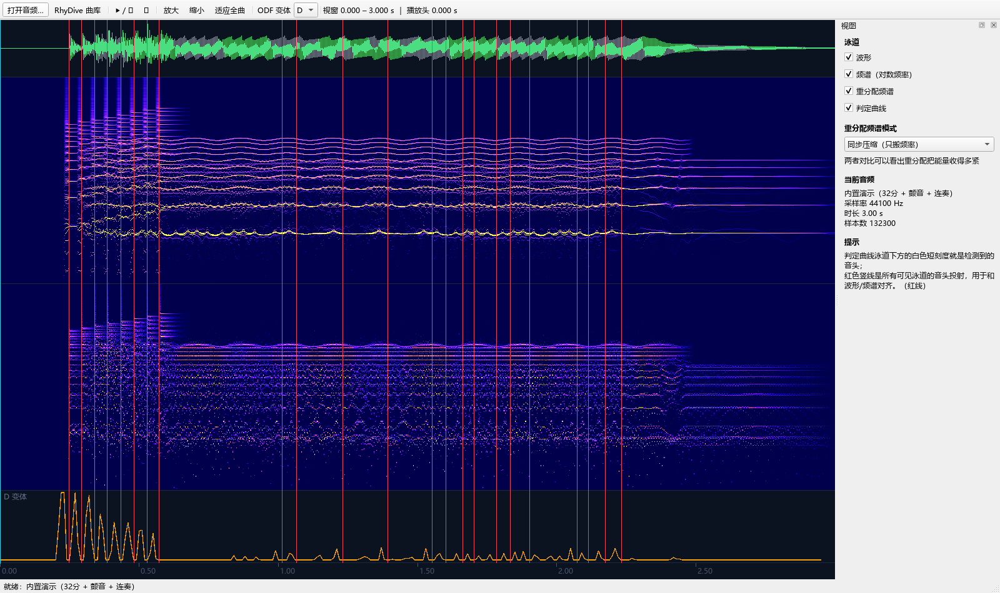
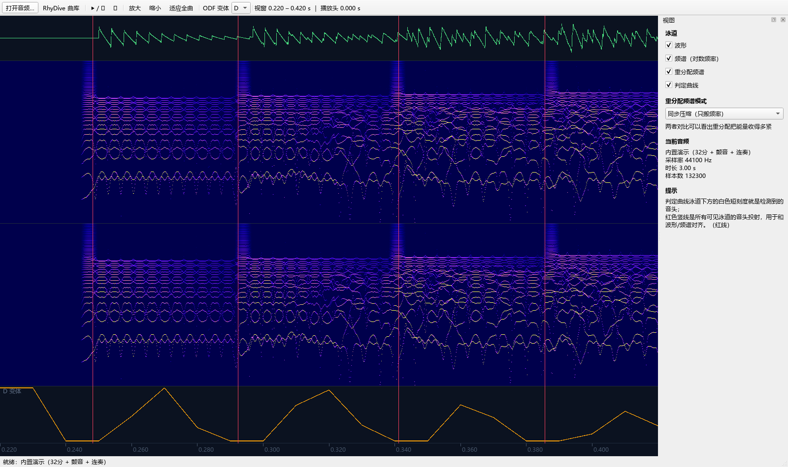

# 03 · 验证计划与 GUI 规格

> 本文档回答：**怎么知道它真的有用？**
>
> 核心原则：**先用合成信号，再上真实素材。**
> 合成信号有 ground truth，能把"算法对不对"和"参数调没调好"分开。

---

## 1. 为什么要先做合成信号

用真实歌曲调参有三个致命问题：

1. **没有 ground truth**——"这里该有一个音符"是你的听感，不是可断言的事实；
2. **无法归因**——表现差时，你分不清是算法结构错了，还是某个阈值不对；
3. **容易过拟合**——在 3 首歌上调到满意的参数，换一首就崩。

合成信号解决前两个，并在进入真实素材前就把"结构性问题"排除掉。

**这一步是硬性前置。** 如果连合成信号里颤音和真实变调都分不开，
后面全部不用做。

---

## 2. 阶段 0 · 合成信号（P0）

### 2.1 信号集

每个信号都是**单声道、44.1 kHz、带精确 ground truth 事件时刻**。
建议用加法合成（谐波堆 + 包络），不依赖任何音频素材。

| 编号 | 名称 | 内容 | Ground truth |
|---|---|---|---|
| **S1** | 颤音长音 | f0 = 220 Hz，6 Hz 正弦颤音，峰峰值 1 半音，持续 2 s，稳定谐波堆 | **0 个事件**（或仅起音处 1 个） |
| **S2** | 音高台阶 | f0 从 220 Hz 阶跃到 261.6 Hz（+3 半音），各自保持 1 s | 1 个事件（t = 1.0 s） |
| **S3** | 同音反复 | f0 = 220 Hz，相同音高，间隙分别为 100 / 60 / 47 ms | 3 个事件 |
| **S4** | 32 分钢琴音型 | BPM 160，32 分音符（间隔 46.9 ms），半音阶上行，每个音带衰减包络 | 与音符数相同（如一串 8 个） |
| **S5** | 弱人声式连奏 | f0 平滑滑音（无瞬态、无能量凹陷），幅度低于 S1/S2 | 每个换音 1 个事件 |
| **S6** | 混合 | S1 + S4 叠加，或加入宽带打击乐 | 各成分事件之和 |

**S1 和 S2 是整套方案的分水岭**：它们的位移量在同一个量级
（都是半音级），必须靠**持续性**而不是位移量分开。

### 2.2 对照的三条曲线

P0 的产出是一张图，同一段信号上叠三条曲线：

| 曲线 | 含义 | 预期 |
|---|---|---|
| **A·现有算法** | 按 [01-analysis.md](01-analysis.md) 的描述**独立重实现**的当前检测器 | 在 S1 上基本安静；在 S4 上把 46.9 ms 的音符合并掉 |
| **B·纯逐 bin 时域导数** | 1/4 半音重 bin + 逐 bin 正差分 | **在 S1 上炸成一片**（预期约 24 次/秒） |
| **C·加 max-filter** | 在 B 的基础上，沿频率做最大值滤波后再求差 | 在 S1 上被压平；在 S4 上仍有峰 |

> **曲线 A 是独立重实现，不是引用原项目代码。** 它的作用是提供一个可比对照，
> 而不是"打擂台"。见 [README.md](../README.md) 的边界声明。

### 2.3 判读标准

| 检查项 | 通过条件 |
|---|---|
| B 在 S1 上确实爆炸 | 误报 **> 15 次/秒**（验证第 2 节的推导） |
| C 在 S1 上被压制 | 误报 **< 2 次/秒** |
| C 在 S4 上仍有峰 | 每个 32 分音符附近都有可判定峰 |
| 持续性判据能分开 S1 / S2 | S1 产生 ≤ 1 个事件；S2 恰好 1 个 |
| 能分开 S3 的三个间隙 | 100 / 60 / 47 ms 三种间隔**都能**输出独立事件 |

**如果"持续性判据"这一行不通过，方案需要重新设计**，不要继续往下做。

### 2.4 同时做出的标定

P0 天然会给出第一批参数：

- 颤音峰峰值 → **move 位移阈值**的下界
- 颤音周期（约 167 ms @6 Hz）→ **holdFrames** 的下界（必须长于半个周期）
- S4 的 46.9 ms → **通道 A 最小间距**的上界

---

## 3. 阶段 1 · 真实素材

### 3.1 素材选取

**不要随机选歌。** 按"是否包含目标难点"选：

| 类型 | 选取标准 | 用途 |
|---|---|---|
| **密集钢琴** | BPM ≥ 140，且含 32 分或更密的跑动段落 | 验证 G1 |
| **人声为主** | 连奏、旋律线平缓、混音中人声不突出 | 验证 G2 |
| **颤音密集** | 美声/弦乐，长音带明显颤音 | 验证 G3（误报） |
| **打击乐为主** | 鼓组突出 | 验证通道 A 独立表现 |
| **常规流行曲** | 4 分/8 分节奏 | 验证**没有退化** |

最后一行很重要：**不能改善了两个场景，却在常规素材上变差。**

### 3.2 人工标注流程

1. 用 GUI 播放，人手标出"该敲的位置"（不需要标音高）；
2. 每段标注 **30–60 秒**即可，不要试图标完整首歌；
3. 每类素材标 **2–3 段**；
4. 标注文件存为简单的 JSON：事件时刻数组 + 可选强度。

**标注粒度**：只需要事件时刻。音高只在评估通道 B 时才需要。

### 3.3 指标

| 指标 | 定义 | 说明 |
|---|---|---|
| **事件级 F1** | 匹配窗 **±50 ms**（宽松）/ **±25 ms**（严格） | 主指标 |
| **密集段召回** | 只统计"间隔 < 80 ms"的标注事件 | **G1 的专职指标** |
| **颤音段误报率** | 长音颤音段的误报数 / 秒 | **G3 的专职指标** |
| **常规段退化** | 在流行曲上与现有算法的 F1 差值 | 必须 ≥ 0 |
| 音高准确率 | 音符级 f0 与标注的偏差（音分） | 仅在评估通道 B 时 |

### 3.4 报告要求

- **分场景报告，不要只报总分。** 一个总 F1 会把"某场景崩了"平均掉。
- **误报和漏检分开报。** 对音游来说，两者的体验代价不同。
- **必须包含失败案例。** 挑出表现最差的片段截图放进去。

---

## 4. 阶段 2 · 测试 GUI

GUI 的目的不是好看，是**让作者三秒钟看懂你在干嘛**，
并且能**拖自己的歌进去立刻得到反馈**。因此它做成**类音频编辑软件（DAW）的布局**。

### 4.1 为什么是 DAW 布局

因为这个项目的核心论证全都发生在**时间轴的同一段上**：

> "这里波形有个起音 → 频谱上确实出现了新的谐波 → 重分配图上它的脊线很干净 →
> 判定曲线在这里有峰 → 但现有算法把它合并掉了。"

这五件事必须**横向严格对齐**才能读出来。所以所有泳道共享同一条时间轴，
缩放与平移全局联动 —— 这正是 DAW 的布局逻辑，也是"方便查看"的唯一可行解法。

### 4.2 泳道

| 泳道 | 内容 | 备注 |
|---|---|---|
| **波形** | 逐像素 min/max 包络 | 看起音、看包络凹陷 |
| **频谱** | 对数频率 STFT 幅度 | 基线表示 |
| **重分配频谱** | 同步压缩（或对数重 bin，可切换） | **本项目的核心视图** |
| **谱面参考** | 人工 .osu 谱面，蓝线；音频载入时自动匹配曲库 | 用来判断"多出来的音头"是不是真的 |
| **判定曲线** | 某一 ODF 变体 + 音头刻度 | 变体 A/B/C/D 可切换 |

外加一层**跨泳道的音头投射线**（红色竖线），把所有泳道串起来。

放大到 0.22–0.42 s 时，32 分音符（间隔 46.875 ms）的每一个音头都能分开看到 ——
这是验证 G1 最直接的手段。

### 4.3 必需的交互

| 交互 | 说明 |
|---|---|
| **滚轮缩放** | 以光标位置为锚点做横向缩放；最小可见跨度 8 ms（足以看清 32 分） |
| **拖动平移** | 左键或中键拖动 |
| **点时间轴 / 双击跳转** | 把播放头移到该时刻 |
| **空格播放 / 暂停** | 播放头与波形严格对齐（见 4.5） |
| **泳道开关** | 侧栏勾选；**不可见的泳道完全不计算** |
| **ODF 变体切换** | A/B/C/D 对照 |
| **重分配模式切换** | 同步压缩 ↔ 对数重 bin（直接可视化 P0 的 F3 结论） |
| **音头标记上限** | 侧栏可调（200 / 500 / 1000 / 2000 / 5000）；超过就只显示计数、不画标记 |
| **峰相对阈值** | 侧栏可调（关 / 0.20 / 0.30 / 0.40 / 0.50），只影响通道 A 变体 |
| **复音数上限** | 侧栏可调（5 / 8 / 10 / 15 / 20 / 不限），只影响变体 F。**实测 >10 会抖** |

### 4.4 按需渲染：三层金字塔（关键工程点）

整首歌的重分配频谱全分辨率算出来是 GB 级的，而**每一帧重算**会让界面直接卡死。
实际采用的是三层结构：

| 层 | 时机 | 内容 |
|---|---|---|
| **整曲概览** | 载入时后台算一次 | 波形 4000 桶 · 频谱 3000 列 × 256 行 · ODF 全曲（10 ms hop） |
| **视窗重采样** | 每次重绘 | 从概览里裁出 [t0,t1] 并重采样，**纯内存操作** |
| **局部精算** | 只在放大超过概览分辨率时 | 单线程"最新者胜"队列，过期的直接丢 |

三条必须记住的教训（都是实测踩出来的）：

1. **缓存键不能太细。** 第一版键里带了 `round(t0,4)` 和 `round(t1,4)`，
   平移时每一帧都是新键 —— 既永远不命中，又让缓存无限增长。
   改成"概览 + 重采样"之后，平移根本不触发重算。
2. **重计算绝不能放在 GUI 线程。** 第一版在 `paintEvent` 里同步跑 STFT+重分配，
   一次平移要卡近一秒。现在画布**只读缓存**，取不到就先用概览顶着。
3. **窗长和 hop 都要跟着缩放走。** 放大到 0.5 ms/px 时还用 46 ms 的窗毫无意义，
   只会算得又慢又糊。现在窗长按 `8 × 跨度/列数` 自适应，夹在 8–46 ms 之间。
   这一条把局部精算从 **788 ms 降到 61 ms**。

4. **折线在高密度下是病态的。** 这是最反直觉的一条：
   判定曲线在全曲视野下有 15,381 个点，而画布只有 1360 px ——
   每个像素列挤了十来个**近乎垂直的大跳变**，Qt 的光栅化器会崩掉性能：

   | 画法 | 耗时 |
   |---|---|
   | 原样画 15,381 点折线 | **2752 ms** |
   | 抽稀到 3,077 点折线 | 223 ms |
   | 每列上下包络折线（2,720 点） | 1062 ms |
   | **每列竖线 `drawLines`（1,360 条）** | **4.4 ms** |

   注意"抽稀"并不管用（还是慢），因为问题不是点数而是**几何形状**。
   现在超过"每像素 1 个点"就改画**逐列上下包络竖线 + 列顶折线**，
   图元数有上界（≤ 2×宽度）。副作用是显示效果反而更好：看到的是真实包络。

5. **标记数量必须有上限。** 以上全部修完之前，全曲视野要 2936 ms；
   现在 **62 ms**。但为了不再出现同类问题，音头标记加了硬上限（默认 1000）：
   超过就整层不画、只显示计数。一屏几万个标记无论如何都是不可读的。

另外两条小的但很关键：

- 播放头是**唯一**每帧变化的东西，所以泳道渲染进 QPixmap 复用，
  播放时只重画那根竖线，不再重建泳道。
- 概览覆盖的是**整首歌**。任何返回概览的地方都必须先裁到视窗 ——
  直接返回会让画面从 0 秒开始左对齐（这个 bug 我踩过）。

### 4.4.1 实测（`scripts/bench_gui.py`）

45 秒信号，画布宽 1360 px（与截图一致）。**放大到局部精算之前**走概览重采样，
所以交互帧的代价就是下面这组数字：

~~~text
整曲概览构建（波形 + 频谱 + ODF，全部后台）   0.65 s

缩放         跨度(ms)    波形(ms)   频谱(ms)   ODF(ms)
全景            45000        0.270        8.680        0.041
1/4           11250        0.462        6.512        0.003
1/16           2812        0.361        4.956        0.004
1/64            703        0.808       10.577        0.003

连续平移（1/16 缩放，三层一起取数）：平均 4.15 ms/帧 ≈ 241 FPS
高倍放大：0.5 s 窗口的局部频谱精算 = 50 ms（后台跑，不阻塞）
~~~

> 阅读这份数据要注意一点：基准是**悲观**的 —— 它在两次取数之间不让事件循环跑，
> 所以局部精算的结果永远进不了缓存，测到的一直是"概览兜底"路径。
> 真实使用中，精算结果 50 ms 后就进缓存，之后同一视窗是字典命中（微秒级）。
>
> 最坏的一帧是**放大后的频谱兜底**（约 10.577 ms），仍远低于 33 ms 的预算。

### 4.5 播放头对齐

播放用 **sounddevice**（回调里直接拿到**已消费的帧数**），并扣掉 stream.latency 得到
接近听觉位置的时刻。不用 QMediaPlayer：它的位置更新粗且抖，
而本工具全靠"音头和波形对齐"来看因果。

> 本机 PySide6 是精简版，**不含 QtMultimedia**，QAudioSink 用不了。
> 代码里的回退顺序是 **sounddevice → QAudioSink → 静音**（静音时其余功能不受影响）。

### 4.6 导入

两条路径：

1. **任意音频文件**（soundfile 支持的格式）；
2. **RhyDive 本地曲库** —— 直接扫描 %APPDATA%\RhyDive\Library\songs\*\song.json，
   列出已经下载到本地的曲目。

第 2 条是刻意的：**让作者能用自己游戏里的歌直接验**，而不是只能看我们的合成信号。

### 4.7 性能要求与实测

实测基准见 `scripts/bench_gui.py`（合成信号）与 `scripts/bench_gui_real.py`（真实歌曲逐档压测）。

| 场景 | 目标 | 实测 |
|---|---|---|
| 整曲概览（波形 + 频谱 + ODF） | 后台，可接受 | 45 s 信号 **0.65 s**；154 s 真实歌曲 **1.7 s** |
| 全曲视野单帧渲染 | 不卡顿 | **56 ms**（修复前是 **2936 ms**） |
| 缩放到 9.6 s 的单帧渲染 | < 100 ms | **66 ms** |
| 缩放到 1 s 以内的单帧渲染 | < 33 ms | **17–30 ms** |
| 局部精算（0.5 s 窗口） | 后台，不阻塞 | **50 ms** |
| 播放时的重绘 | 不卡顿 | 只重画播放头，与视窗大小无关 |

关键约束：**前置计算与后处理必须分开缓存**，改阈值只应重跑峰值挑选，不应重跑 STFT
（这一项仍待实现，见 4.8）。

### 4.8 当前实现状态

已实现（见 gui/）：

- DAW 布局、五条泳道（波形 / 频谱 / 重分配频谱 / 谱面参考 / 判定曲线）、共享时间轴
- 滚轮缩放（光标为锚点） / 拖动平移 / 跳转 / 播放（sounddevice）
- 任意文件导载 + RhyDive 曲库导入
- **三层金字塔按需渲染**：整曲概览（后台）+ 视窗重采样 + 局部精算（最新者胜队列）
- 窗长随缩放自适应（8–46 ms）
- 泳道渲染走 QPixmap 缓存，播放只重画播放头
- **谱面参考泳道**：载入音频时按文件名自动匹配 RhyDive 曲库谱面（蓝线），
  与检出（红线）并排比对；工具栏「载入谱面…」（Ctrl+L）可手动指定
- 无头截图模式（`python gui/main.py --demo --shot out.png --t0 --t1`），
  会等待后台算完再抓图，因此可复现；并打印 `缺数据的泳道=[...]` 便于排查
- 基准脚本 `scripts/bench_gui.py`（合成）与 `scripts/bench_gui_real.py`（真实歌曲逐档）

待办：

- 参数滑块（灵敏度、持续性窗长）与"只重跑后处理"的快路径
- 谱峰轨迹叠加层（通道 B 实现后）
- 事件列表（可点击跳转到某个音头）
- 垂直方向缩放（把频率轴放大看低次谐波）
- 精算瓦片吸附（消除 9.6 s 缩放档约 66–72 ms/帧的顿挫）

---

## 5. 验收标准

方案被认为成立，需要同时满足：

| 编号 | 标准 | 对应目标 |
|---|---|---|
| A1 | 合成信号 S1/S2 能被分开（见 2.3） | 结构可行性 |
| A2 | S4 的 46.9 ms 间隔能输出独立事件 | G1 |
| A3 | S5 能检出换音，且不是靠能量突变 | G2 |
| A4 | 颤音段误报率显著低于"纯逐 bin 导数" | G3 |
| A5 | 每个输出事件都带 kind 标签 | G4 |
| A6 | 能在浏览器/Node 里离线跑完一首歌 | G5 |
| A7 | 常规流行曲上 F1 不低于现有算法 | 不退步 |
| A8 | GUI 能拖入任意本地音频并显示三条曲线 | 可用性 |

**A1 和 A2 是门槛。** 任何一条不过，不要进入真实素材阶段。

---

## 6. 反模式（不要做的事）

1. **不要用真实歌曲调参然后宣称有效。**
   那是过拟合，换一首就崩。
2. **不要只报总 F1。** 分场景、分误报/漏检。
3. **不要隐藏失败案例。** 本项目的价值在于诚实，
   作者会自己拿歌来试，藏不住。
4. **不要为了赶上现有算法的总分而牺牲可解释性。**
   如果两个方案分数一样，可解释的那个更值得交付。
5. **不要在没跑 S1 的情况下增加频率分辨率。**
   参见 [02-design.md](02-design.md) 第 2 节。
6. **不要忘记同音连奏是物理不可分的。**
   把它当作已知局限写进结论，不要试图"调出来"。
